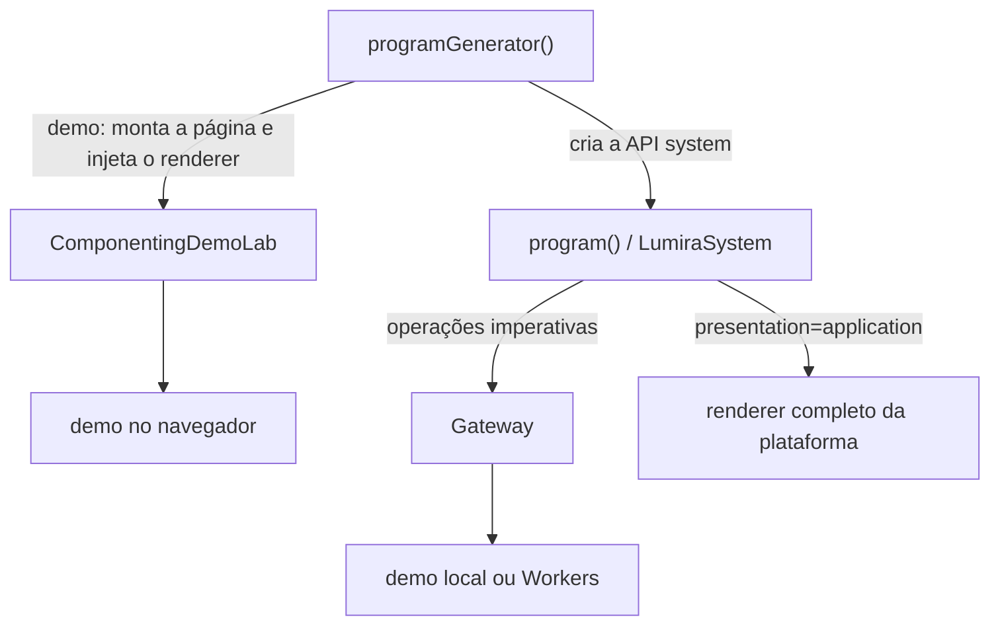

# Apresentação técnica · frontend Lumira

## Interface

O projeto mantém as telas do esqueleto Cognoscere e usa TypeScript no fluxo frontend, nas páginas, nos serviços e nos testes. `src/components.ts` reúne as páginas e partes stateful do laboratório como Custom Elements, seus templates stateless, specs e dados iniciais, além dos componentes da plataforma. `src/componenting-demo-lab.ts` contém os elementos stateful do laboratório, a lógica de interação e montagem e o `programGenerator()` principal; ele envia fixture e situação mock para os componentes de página.

## Programa principal

`src/componenting-demo-lab.ts` contém o único `function* programGenerator()`: decide apresentação e ordem de montagem. Ele passa o modo ao `program()`, que instancia internamente configurações, domínios e serviços. No demo, `ComponentingDemoLab` usa os componentes, specs e dados iniciais de `src/components.ts` e injeta a página como renderer integral em `program()`; usa o `LumiraSystem` como API, com os eventos e a renderização da plataforma desativados. `?presentation=application` reserva o renderer e os eventos de `program()` para montar a plataforma inteira. `?mode=worker` seleciona o gateway Workers na plataforma. O primeiro `yield` entrega o `LumiraSystem`; `src/main.ts` reexporta a mesma instância, sem montagem paralela.



O sistema não é anexado a `window`. Componentes não criam uma store global. O gateway demo usa dados fictícios em memória; o modo Workers é apenas o contrato HTTP previsto.

## Execução

```sh
npm install
npm run dev
```

Use o endereço localhost mostrado pelo Vite para ver os componentes. Acrescente `?presentation=application` para abrir a plataforma; a tela de acesso permite escolher um dos três perfis demonstrativos, sem credenciais reais. Para validar e empacotar:

```sh
npm run check
npm run build
npm run preview
```

`npm run check` executa TypeScript em modo estrito e doze testes de domínio, interface e substituição do renderer. `npm run build` cria `dist/`.

## Sondagem e coeficiente idade/série

A tela de matrícula no nivelamento começa com idade e série, depois abre um stepper de cinco questões para uma competência demonstrativa. A barra dinâmica soma até 100 pontos de acordo com as respostas escolhidas. O coeficiente idade/série permanece indefinido porque o repositório consultado não estabelece uma fórmula; a pontuação mostra apenas o estado do protótipo e não define nível, nota ou avanço escolar.
