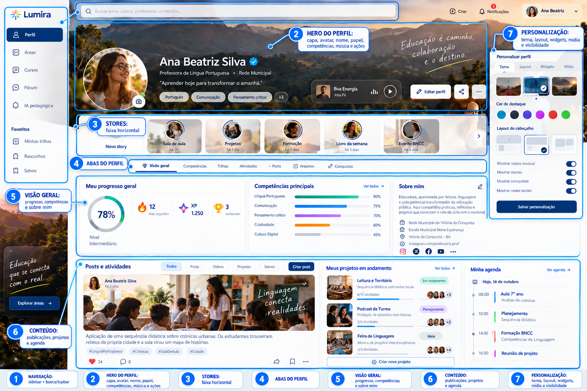
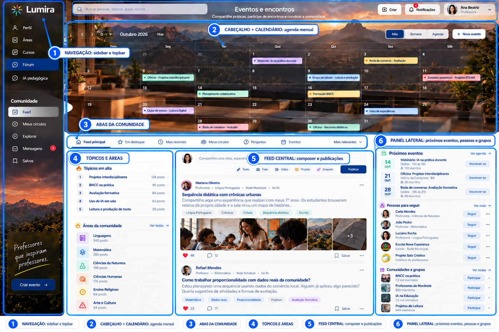

# Composição das páginas Lumira

Este documento registra a composição implementada no Componenting Demo Lab. As quatro páginas, seus componentes, specs e dados vivem no monólito `src/components.ts`. `src/componenting-demo-lab.ts` coordena o estado interativo e a montagem imperativa única.

## Evidência

| Página | Base | O que a referência sustenta |
|---|---|---|
| Acesso | [Mapa do site](../design-references/10_Mapa_do_Site.png) | A rota pública, login, recuperação de senha e demonstração. O mapa não define o layout visual. |
| Perfil professor | [Tela de perfil](../design-references/11_Perfil_Personalizavel_Stories_Musica.png) | Shell autenticado, capa e identidade, stories, abas, painéis de perfil e painel de personalização. |
| Perfil aluno | Perfil docente e mapa do site | Variação derivada. A referência não mostra uma tela discente. Elementos de progresso precisam respeitar autorização e privacidade. |
| Social | [Comunidade e calendário](../design-references/13_Comunidade_Calendario_Horizontal.png) | Shell autenticado, calendário mensal, navegação da comunidade, feed em colunas, tópicos, eventos e grupos. |

## Referências anotadas

Marcações sobre as duas telas de produto fornecidas. Os números ligam as regiões da captura à composição descrita abaixo.

### Perfil professor



### Social e comunidade



## Gráfico de composição

As caixas externas são partes de página que fazem sentido como unidades da lista de demonstração. Os itens internos são componentes visuais que compõem cada parte. `observed` indica conteúdo visível na referência; `derived` indica proposta inferida.

```mermaid
flowchart TB
  subgraph Acesso["Acesso · derived do mapa de navegação"]
    A1[PublicShell]
    A2[AccessPage]
    A3[Brand e contexto]
    A4[AccessForm: email e senha]
    A5[Login · recuperar senha · demo]
    A1 --> A2 --> A3
    A2 --> A4 --> A5
  end

  subgraph Professor["Perfil professor · observed + derived"]
    P1[WorkspaceShell]
    P2[ProfileHero]
    P3[StoriesStrip]
    P4[ProfileTabs]
    P5[ProfileOverview · 3 painéis]
    P6[Activity · projects · agenda]
    P7[PersonalizationPanel]
    P1 --> P2 --> P3 --> P4 --> P5 --> P6
    P2 -. abre edição .-> P7
  end

  subgraph Aluno["Perfil aluno · derived"]
    S1[WorkspaceShell]
    S2[StudentProfileHero]
    S3[StoriesStrip]
    S4[ProfileTabs]
    S5[LearningProgress autorizado]
    S6[PrivacyNotice]
    S1 --> S2 --> S3 --> S4 --> S5 --> S6
  end

  subgraph Social["Social · observed"]
    C1[WorkspaceShell]
    C2[CommunityHeader + Calendar]
    C3[CommunityTabs]
    C4[Coluna esquerda: tópicos e áreas]
    C5[Coluna central: composer e PostFeed]
    C6[Coluna direita: eventos, pessoas e grupos]
    C1 --> C2 --> C3
    C3 --> C4
    C3 --> C5
    C3 --> C6
  end
```



## Esboço por página

### Acesso

```text
PublicShell
└── AccessPage
    ├── BrandContext
    └── AccessForm
        ├── EmailField
        ├── PasswordField
        ├── SubmitAction
        └── Login / recuperação / demonstração
```

Todos os elementos visuais do acesso são derivados: o mapa informa os destinos e ações, mas não fornece uma tela para copiar. No laboratório, o formulário é demonstrativo e não autentica.

### Perfil professor

```text
WorkspaceShell
├── Sidebar + Topbar + Search
└── TeacherProfilePage
    ├── ProfileHero [capa, avatar, nome, papel, escola, frase, competências]
    │   ├── MusicStatus
    │   └── ProfileActions [editar, compartilhar, mais]
    ├── StoriesStrip [criar story + stories]
    ├── ProfileTabs
    ├── ProfileOverview
    │   ├── ProgressCard
    │   ├── CompetenciesCard
    │   └── AboutCard [bio, vínculo escolar, redes]
    ├── ProfileActivity
    ├── OngoingProjects
    ├── Agenda
    └── PersonalizationPanel [tema, layout, widgets, mídia e visibilidade]
```

O topo do perfil e o painel de personalização são diretamente observados. Turmas, materiais e resumo docente no fixture atual são conteúdo de demonstração derivado; a imagem não define todos esses dados.

### Perfil aluno

```text
WorkspaceShell
└── StudentProfilePage [derived]
    ├── ProfileHero [identidade pública discente]
    ├── StoriesStrip
    ├── ProfileTabs
    ├── LearningProgress [somente dados autorizados]
    └── PrivacyNotice
```

É uma proposta baseada na estrutura visual do perfil docente, não uma extração de uma tela discente. Não mostrar notas, respostas, dados individuais ou progresso sem autorização explícita.

### Social e comunidade

```text
WorkspaceShell
└── CommunityPage
    ├── CommunityHeader
    ├── MonthlyCalendar [mês, navegação, eventos]
    ├── CommunityTabs [feed, destaque, recentes, círculos, perguntas, eventos]
    └── CommunityColumns
        ├── TopicPanels [tópicos em alta, áreas]
        ├── MainFeed [PostComposer, PostCard, reações e comentários]
        └── CommunityAside [próximos eventos, pessoas, grupos]
```

## Dados e estados da demonstração

`src/components.ts` mantém `referenceScreenSpecs`, `initialComponentData` e os componentes do laboratório no mesmo arquivo. Cada tela contém regiões selecionáveis; cada região identifica `id`, `title`, `description`, `evidence`, `fixtureKey` e `kind`. `AccessPageComponent`, `TeacherProfilePageComponent`, `StudentProfilePageComponent` e `CommunityPageComponent` são Custom Elements stateful. Cada região é um `<lumira-page-part>` stateful, reutilizado durante atualizações da mesma página; cada elemento cria o state iterator no `constructor`. Funções stateless geram apenas o markup interno de cada peça.

`ComponentingDemoLab` e `DemoDataEditor` são `HTMLElement`s com state iterators criados no construtor. O laboratório permite alternar `ready`, `loading`, `empty`, `error` e `forbidden`, além do papel demonstrado. O loading é transitório: após 1,1 segundo retorna a `ready`; trocar de tela cancela o timer. A cada render, `componenting-demo-lab.ts` monta e envia `ComponentMockSituation` — `screenId`, `fixtureKey`, `selectedRegionId`, `role` e `status` — junto à fixture da tela para o Custom Element correspondente; a página encaminha a mesma situação às partes. Cada `<lumira-page-part>` guarda pelo iterator as seleções de abas e filtros, toggles, valores de campos, feedback local e publicações criadas no feed; envio de formulário e controles nativos refletem nesse estado. Essas interações são locais à demonstração e não alegam persistência de backend. A troca de página ajusta o papel inicial e volta o cenário para `ready`. As regiões aparecem como partes completas de página na lista, e seus elementos internos são montados juntos. O editor altera o fixture JSON e, ao aplicar JSON válido, atualiza a prévia da mesma página; JSON inválido exibe o erro e preserva os dados já aplicados.

As árvores acima correspondem às composições implementadas. `observed`, `derived` e `navigation-only` deixam explícita a origem visual de cada região; o formulário de acesso e o perfil de aluno são derivados e continuam sendo protótipos visuais.

## Tokens e assets

`src/design-tokens.json` guarda as constantes de fontes, cores, espaçamento, raios e sombras. `src/design-tokens.css` publica os mesmos valores como custom properties CSS usadas pelo laboratório. `src/assets/manifest.json` organiza os assets por página: capa gerada para perfil e cabeçalhos de página, foto gerada para publicações da comunidade e imagem legada reservada ao modo de apresentação da plataforma.

Os arquivos locais estão em `src/assets/profile/serra-dourada-cover.webp` e `src/assets/community/sala-colaborativa.webp`. Iniciais derivadas dos fixtures representam avatares; não há dependência de imagens externas.

## Relação com o laboratório

| Spec atual | Parte selecionável | Conteúdo interno representado |
|---|---|---|
| `access` | Apresentação pública; Formulário de acesso | marca/contexto; campos e ações de acesso |
| `teacher-profile` | Navegação lateral; Barra superior; Hero; Stories; Abas; Progresso; Competências; Sobre; Publicações; Projetos; Agenda; Personalização | tela completa do perfil docente e suas partes selecionáveis |
| `student-profile` | Navegação lateral; Barra superior; Hero; Stories; Abas; Percurso; Conquistas; Apresentação e privacidade | tela discente derivada e suas partes selecionáveis |
| `community` | Navegação lateral; Barra superior; Cabeçalho e calendário; Abas; Tópicos; Feed; Painel lateral | tela social completa com calendário, posts, eventos e grupos |

`observed`, `derived` e `navigation-only` acompanham cada tela ou região na interface para mostrar a origem da composição.
