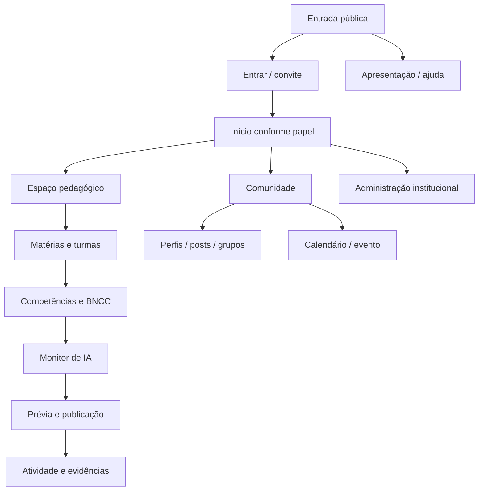

# Lumira — Estrutura visual, site map e requisitos

**Versão 1.0 · Especificação UX e produto**

Base: *Lumira_Projeto_Integral* e *Lumira_Apresentacao_Institucional_Sondagem_Inferencial*. O capítulo 01 governa a experiência: IA como instrumento da especialidade docente, produção e avaliação revisáveis, trabalhos de compreensão, circulação autorizada e participação social.

## Princípios de organização da interface

1. A navegação começa pelo contexto de trabalho (matéria, turma, curso, atividade), não por uma lista indiferenciada de ferramentas.
2. Preparação docente diferencia três objetos: interpretação da competência, orientação de geração e contrato de avaliação.
3. A prévia destinada ao estudante fica visualmente separada da análise interna do monitor.
4. Cada operação de IA mantém origem, versão e estado; gerar não significa publicar.
5. O espaço pedagógico reservado e a apresentação social são superfícies distintas, relacionadas por ações explícitas de compartilhamento.
6. Calendário e eventos são parte da comunidade; leaderboard representa somente resultados homologados do evento.
7. O mesmo sistema de navegação preserva capacidades centrais em desktop e celular.

## Site map



### Hierarquia navegável por papel

- **Público:** início · sobre a Lumira · proposta pedagógica · acessibilidade/privacidade · entrar · aceitar convite.
- **Professor:** início docente · matérias e turmas · catálogo BNCC/competências · biblioteca de referências · monitor de IA · contratos e versões · cursos e materiais · atividades · respostas e evidências · perfil · comunidade · calendário/eventos · notificações · configurações.
- **Aluno:** início de aprendizagem · minhas matérias/cursos · competências e percurso · atividades abertas · respostas/devolutivas · materiais de apoio · portfólio · perfil público escolhido · comunidade/grupos · calendário/eventos · configurações.
- **Administração escolar:** painel institucional · pessoas/convites · turmas e vínculos · matérias/atribuições docentes · políticas de visibilidade · auditoria operacional · integração/estado do serviço.
- **Revisão/moderação:** catálogo e interpretações curriculares · modelos de contrato · fila de publicações/reportes · eventos e homologações. Escopo de acesso separado do acompanhamento individual.

## Navegação e estrutura visual

**Desktop:** barra superior com marca, contexto atual, busca, notificações e perfil; navegação lateral por papel (recolhível); conteúdo central; painel contextual à direita somente quando a tarefa precisar de fontes, critérios, histórico ou detalhes. A trilha de navegação indica instituição → matéria → turma/competência → atividade.

**Celular:** barra superior reduzida; navegação inferior para início, aprender/trabalhar, comunidade e perfil; menu de contexto para páginas secundárias; painel contextual torna-se drawer acessível. Nenhum controle fica sobre texto, questão ou botão de envio.

**Área de trabalho docente:**

```text
┌ Marca / instituição / busca / notificações / perfil ──────────────────┐
│ Navegação       │ Matéria > Turma > Atividade       │ Contexto        │
│ Início          │ Cabeçalho: estado e objetivo       │ Fontes usadas   │
│ Turmas          │ Conteúdo principal                 │ Revisões        │
│ Competências    │ Editor / prévia / respostas         │ Evidências      │
│ Materiais       │ Ação primária contextual            │ Ajuda           │
└────────────────┴────────────────────────────────────┴─────────────────┘
```

**Área de aprendizagem do aluno:**

```text
┌ Lumira / voltar à matéria / avisos / perfil ─────────────────────────┐
│ Matéria e atividade        │ Questão contextual                      │
│ Progresso da atividade     │ Fontes permitidas / dados              │
│ Instruções                 │ Campo de resposta                      │
│ Materiais de apoio         │ Salvar rascunho · enviar                │
│                            │ Confirmação e devolutiva quando aberta │
└────────────────────────────┴───────────────────────────────────────┘
```

## Fluxos de navegação centrais

**Preparar e publicar:** matéria/turma → competência e referências → editar contratos → selecionar fonte → pedir geração → revisar prévia → configurar aplicação → pré-visualizar como aluno → publicar.

**Compreender evidências:** aplicação aberta → aluno interpreta e responde → entrega confirmada → avaliação por critério → revisão docente → decisão pedagógica registrada → nova proposta/material.

**Compartilhar:** material revisado → criar publicação derivada → escolher público/atribuição → publicar → interações e grupos autorizados. Relatório e resposta privados não acompanham o post.

**Participar de evento:** calendário social → página do evento → consultar propósito/regras → inscrever-se → produzir/participar → resultado homologado → leaderboard e perfil conforme permissão.

## Requisitos

**Prioridade:** MUST = necessário para o núcleo seguro; SHOULD = necessário ao produto completo, com sequenciamento; os demais ficam registrados para evolução.

| ID | Área | Requisito | Ator | Prioridade | Critério de aceite resumido |
|---|---|---|---|---|---|
| F01 | Identidade | A aplicação deve oferecer entrada, convite e recuperação de acesso para os papéis previstos. | Todos | MUST | Sessão autenticada e recuperação não revela se um endereço existe. |
| F02 | Identidade | A pessoa pode manter perfil social personalizável separado do perfil pedagógico reservado. | Professor/aluno | MUST | Editar capa ou apresentação social não altera avaliações nem competências privadas. |
| F03 | Instituição | Administradores criam instituições, turmas, convites e vínculos com papéis explícitos. | Admin | MUST | Convite expirado ou revogado não cria vínculo. |
| F04 | Navegação | A navegação global adapta opções ao papel e mantém indicação de localização atual. | Todos | MUST | Teclado e leitor de tela alcançam o mesmo destino. |
| F05 | Currículo | O catálogo relaciona habilidade BNCC à competência aplicada, mantendo texto-fonte e interpretação separados. | Professor/revisor | MUST | Registro exibe fonte, versão e autoria da interpretação. |
| F06 | Competências | Uma atividade pode referenciar múltiplas habilidades e competências; cobertura não implica evidência automática. | Professor | MUST | Matriz mostra quais critérios cada questão pode observar. |
| F07 | Contratos IA | Professor edita e versiona separadamente síntese de geração e contrato de avaliação. | Professor | MUST | Alteração cria nova revisão e não substitui a usada em aplicações anteriores. |
| F08 | Fontes | Professor seleciona trechos e materiais autorizados com proveniência para geração. | Professor | MUST | Prévia permite inspecionar fonte e não inventa citação como autorizada. |
| F09 | Geração | Monitor retorna prévia contextual, separando conteúdo do aluno e notas internas. | Professor | MUST | Conteúdo só chega ao aluno após aprovação e publicação explícita. |
| F10 | Geração | Professor pode editar, regenerar, rejeitar ou aprovar a prévia sem perder versão anterior. | Professor | MUST | Histórico identifica prompt/contrato e mudanças humanas. |
| F11 | Sondagem | Plano de sondagem organiza cinco situações por competência como configuração inicial. | Professor | SHOULD | Plano varia contextos; configuração é editável e não apresenta uma questão como diagnóstico conclusivo. |
| F12 | Aplicação | Professor escolhe turma, janela, tentativas, instruções e forma de devolutiva antes de abrir atividade. | Professor | MUST | Prévia de aluno corresponde exatamente à revisão publicada. |
| F13 | Resposta | Aluno pode ler fontes, responder, salvar rascunho e receber confirmação de entrega. | Aluno | MUST | Reenvio idempotente não duplica a mesma tentativa. |
| F14 | Avaliação | Monitor associa cada atribuição a critério específico e trecho verificável da resposta. | Professor | MUST | Citação não localizada é sinalizada; modelo não cria pontuação global por padrão. |
| F15 | Revisão | Professor aceita, corrige ou contesta parecer mantendo saída original e justificativa da revisão. | Professor | MUST | Auditoria diferencia parecer automático de revisão docente. |
| F16 | Evidências | Painel agrega manifestações observadas; conjuntos podem se sobrepor e sempre apontam às evidências. | Professor | MUST | Nenhuma pessoa recebe rótulo permanente por ocorrência isolada. |
| F17 | Progressão | Mudança de estado pedagógico exige regra explícita e decisão atribuída, apoiada por múltiplas evidências. | Professor | MUST | Parecer de uma resposta não promove nem rebaixa automaticamente. |
| F18 | Cursos | Professor organiza glossário/base conceitual, linha de avanço e contextos de compreensão. | Professor | SHOULD | Material apresenta relação com competências e sequência revisável. |
| F19 | Materiais | Professor cria material adicional a partir de evidências observadas, revisa e disponibiliza à turma. | Professor | MUST | Material não expõe respostas nem identidade que motivou sua criação. |
| F20 | Publicação | Material aprovado pode originar post contextualizado com público e licença/reutilização definidos. | Professor | MUST | Objeto público é separado de relatório reservado. |
| F21 | Comunidade | Feed oferece posts, comentários, grupos, convites e produções autorizadas. | Professor/aluno | SHOULD | Cada interação respeita vínculo, público e moderação. |
| F22 | Eventos | Calendário mensal integra cabeçalho da área social e eventos têm páginas próprias. | Todos | MUST | Evento exibe data, responsável, público e regras; grade possui alternativa acessível. |
| F23 | Eventos | Leaderboard fica circunscrito a evento/modalidade e só aparece após homologação. | Organizador | SHOULD | Resultado não muda automaticamente o perfil curricular. |
| F24 | Acessibilidade | Formulários, navegação, feedback e componentes atendem uso por teclado e conteúdo responsivo. | Todos | MUST | Fluxos centrais completáveis em viewport móvel e teclado. |
| S01 | Segurança | API verifica identidade, instituição, vínculo, papel e propriedade em cada leitura e mutação. | Sistema | MUST | Testes negativos cobrem IDs de outros usuários e instituições. |
| S02 | Segurança | Tokens GitHub, Metis e identidade ficam em secrets do ambiente servidor. | Sistema | MUST | Bundle e tráfego do browser não contêm credenciais. |
| S03 | Privacidade | Entregas, avaliações, conversas e matrícula ficam fora do histórico Git público. | Sistema | MUST | Busca e logs não expõem conteúdo privado. |
| S04 | Privacidade | O modelo recebe dados mínimos, com IDs opacos e sem nome do aluno por padrão. | Sistema | MUST | Prompt gravado em logs não contém identificadores diretos. |
| S05 | Privacidade | Retenção, correção, exportação e exclusão devem ser configuráveis segundo política institucional. | Admin | MUST | Procedimento executado e auditado em staging. |
| S06 | Integridade | Publicações Git usam revisão esperada, commit não forçado e resolução de conflito. | Sistema | MUST | Concorrência não sobrescreve conteúdo mais recente. |
| S07 | Resiliência | Jobs de IA têm estado persistido, idempotência, limite de tentativas e retomada após falha. | Sistema | MUST | Timeout não cria avaliação fictícia nem perde submissão. |
| S08 | Confiabilidade | Saída do Metis é validada por schema e referências antes de persistir ou exibir. | Sistema | MUST | JSON inválido resulta em erro explícito ou retry controlado. |
| S09 | Memória | Especialidade/metadados de memória são registrados apenas quando confirmados pelo endpoint. | Sistema | MUST | Não alegar ativação de arquivo safetensors sem confirmação de execução. |
| S10 | Auditoria | Sistema mantém revisões de contrato, material, inferência e decisão docente vinculadas. | Sistema | MUST | Uma avaliação antiga pode ser reproduzida com suas versões de insumo. |
| O01 | Observabilidade | Painel técnico distingue falha do modelo, publicação, autorização e resposta do aluno. | Operação | SHOULD | Métricas sem conteúdo pessoal: latência, falha, tentativas e fila. |
| O02 | Operação | Staging e produção usam repositórios/segredos e dados distintos. | Operação | MUST | Deploy de staging não altera dados nem publicação de produção. |
| O03 | Recuperação | Backups do estado operacional e do acervo permitem restaurar referências cruzadas. | Operação | SHOULD | Ensaio encontra revisões citadas pelas atividades restauradas. |
| O04 | Compatibilidade | Adaptador Metis isola diferenças do endpoint e documenta suporte real testado. | Desenvolvimento | MUST | Contrato de geração e avaliação executado no serviço real antes do aceite. |

## Rastreabilidade ao material base

- **Capítulo 01, pp. 2-7:** princípios UX, separação geração/avaliação, sondagem contextual, interação, compartilhamento e revisão.
- **Metodologia, pp. 13-25:** referências BNCC, competências aplicadas e contextos.
- **Acesso/perfil, pp. 27-46:** entrada, perfis e privacidade.
- **Competência/cursos, pp. 48-63:** critérios, dependências, materiais e progressão.
- **Comunidade/eventos, pp. 65-75:** perfis, publicações, grupos, calendário, eventos e leaderboard localizado.
- **Monitor, pp. 77-86:** contratos separados, respostas estruturadas, revisão e memória.
- **Implantação, pp. 94-98:** adesão e sequência institucional.
- **Repositório conceitual:** competência.md, Teste de sondagem na matrícula.md, Produção de conhecimento.md, perfil.md e Readme.md; decisões antigas de avanço por ranking não se sobrepõem à experiência revisada.

## Escopo de telas para protótipo navegável

1. **T01 Início docente:** turmas, atividades ativas, geração em andamento e pendências de revisão.
2. **T02 Espaço da matéria:** contexto, competências, biblioteca e cursos da turma.
3. **T03 Editor de competência/contratos:** abas independentes para interpretação, geração e avaliação; histórico visível.
4. **T04 Prévia do monitor:** enunciado de aluno, fontes, notas internas e comandos revisar/regenerar/aprovar.
5. **T05 Publicação da atividade:** público, janela, tentativas, política de devolutiva e prévia do aluno.
6. **T06 Atividade do aluno:** questão contextual, referência, resposta e confirmação de entrega.
7. **T07 Painel de evidências:** critérios, atribuições descritivas, citações e revisão docente.
8. **T08 Material/curso:** base conceitual, linha de avanço, contextos e materiais adicionais.
9. **T09 Comunidade:** feed com calendário mensal integrado ao cabeçalho, grupos e publicações.
10. **T10 Página de evento:** objetivo, regras, participação, materiais e leaderboard do evento.
11. **T11 Perfil:** edição social e controles de visibilidade; seção pedagógica reservada separada.
12. **T12 Administração:** convites, papéis, turmas e estado operacional.

## Critérios de aceite do protótipo visual

- Navegar do início docente a uma atividade publicada sem telas órfãs.
- Ver a mesma atividade em modo professor e modo aluno, com diferença clara entre conteúdo público e monitoramento.
- Representar estado vazio, carregando, erro recuperável, aguardando revisão e concluído.
- Mostrar de onde vem o material e qual revisão está em uso.
- Permitir retorno e edição sem apagar rascunho.
- Não expor parecer ou evidência individual em perfil, feed, evento ou busca pública.
- Incluir breakpoint móvel e alternativa acessível ao calendário visual.

## Sequenciamento sugerido para desenhar no Codex

**Camada 1:** mapa e shell global por papel. **Camada 2:** fluxo docente de editor, prévia e publicação. **Camada 3:** entrega e evidências do aluno/professor. **Camada 4:** curso e material derivado. **Camada 5:** comunidade, evento e administração. Este encadeamento mantém a navegação subordinada ao percurso de compreensão descrito no capítulo 01.
